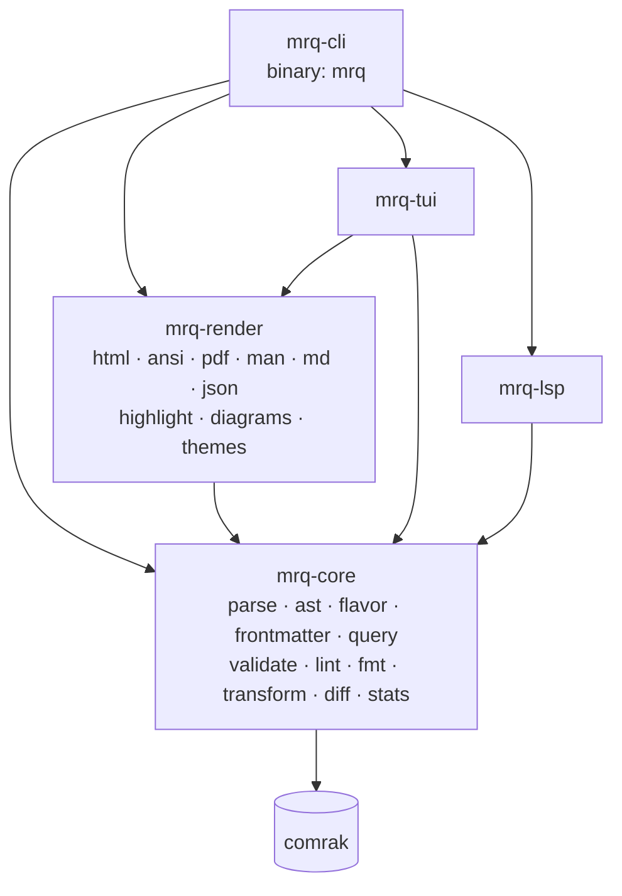
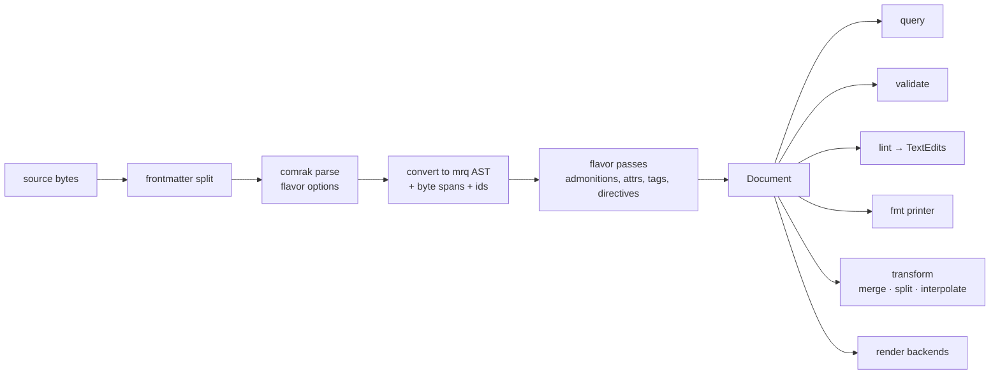
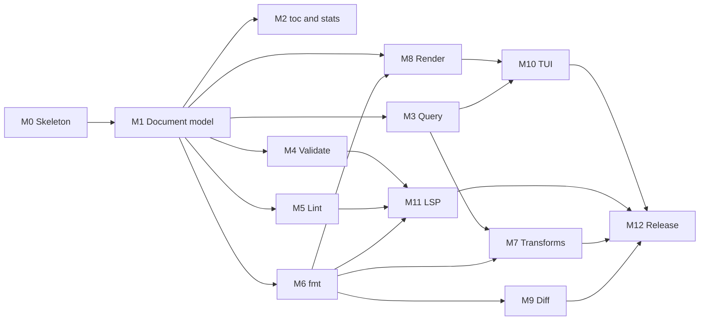

# mrq Implementation Plan

This plan implements the tool described in [README.md](README.md). It has three parts: the architecture and the decisions behind it, then milestones made of checkbox tasks, then risks. Each task is sized for one focused session, and its acceptance criteria (**AC**) say when it counts as done. Tasks within a milestone run in order unless marked *(parallel)*. A milestone may depend only on earlier milestones.

## Decisions

| Topic | Decision |
| --- | --- |
| Language / edition | Rust 2024 edition on the latest stable toolchain, currently `1.99.1`. `rust-toolchain.toml` pins `channel = "1.99.1"` and the workspace sets `rust-version = "1.99"` (MSRV), checked in CI. Never pick an older toolchain just because it is installed locally; check `rustup run stable rustc --version` and use the newest stable release. |
| License | MIT OR Apache-2.0 |
| Crates | Cargo workspace. `mrq-core` (library) and `mrq-cli` (binary `mrq`; the name `mrq` is taken on crates.io) are published to crates.io. `mrq-render`, `mrq-tui` and `mrq-lsp` are internal at first (`publish = false`) and published once their APIs settle. |
| Distribution | GitHub Releases via cargo-dist, plus Homebrew tap, Nix flake and AUR (`mrq` and `mrq-bin`) |
| Task runner | A `Justfile` is the single entry point for local work and CI: `fmt`, `fmt-check`, `lint` (clippy, `-D warnings`), `test`, `deny`, `check` (fmt-check + lint + test), `build-debug`, `build-release`, `install`, `coverage` (tarpaulin, fails below 80% line coverage) and the cross-compilation recipes. CI calls `just` recipes instead of repeating cargo invocations. Recipes have a one-line doc comment so `just --list` documents them. |
| Release targets | Linux `x86_64`/`aarch64` gnu and musl (static), macOS `x86_64`/`aarch64`, Windows `x86_64` (MSVC on Windows hosts, MinGW via `cross` from other hosts). `build-native-*` recipes use the host cargo and only need `rustup target add`; `build-cross-*` recipes build in Docker via [`cross`](https://github.com/cross-rs/cross). Both verify their prerequisites (installed rustup target, `cross` binary, reachable Docker daemon) and fail with the fix command. Binaries land in `target/<triple>/release/mrq[.exe]`. Release binaries use rustls, never OpenSSL, so no target needs a system TLS library. |
| Parser | comrak (arena AST, sourcepos, full GFM and extensions), wrapped behind a `Parser` trait in `mrq-core`. The rest of the code never sees comrak types: they are converted into mrq's own owned AST. A lossless rowan CST can replace or supplement comrak later without breaking the public API. |
| AST | An owned tree defined by mrq (`mrq_core::ast`) with byte-offset spans on every node, mrq-specific node kinds (admonition, wikilink, embed, tag, include directive, …), stable node ids, and an mdast-like JSON projection that is a versioned public contract |
| Source edits | `lint --fix`, `interpolate --in-place`, `toc --insert` and LSP edits all go through `TextEdit { range: ByteRange, replacement }` applied to the original source. Nothing in these paths round-trips through the AST, so untouched bytes stay exactly as they were. |
| fmt | mrq's own Markdown printer over the mrq AST (comrak's `format_commonmark` serves as a reference only). It has width-aware wrapping, table alignment and list renumbering. Raw source slices are reused where the printer has no opinion (HTML blocks, unknown extensions). |
| Flavors | A `Flavor` is data plus hooks: comrak option set, slugger, extra block/inline AST passes, and printer rules. A registry holds `commonmark`, `gfm` (default), `obsidian` and `mkdocs`. Syntax that comrak doesn't parse natively (mkdocs `!!!` admonitions, `{#id}` attributes, `%%comments%%`, `#tags`) is recognized by post-parse passes that re-scan the source spans of the affected blocks. |
| Query | One engine over the mrq AST that evaluates an internal `QueryPlan`. Three front-ends compile to it: an mdq-inspired selector DSL (default), CSS-like selectors (`--css`), and jq (`--jq`, embedded jaq-core/jaq-std over the JSON projection). |
| Config | `.mrq.yaml`, layered (user config, then ancestor directories, then CLI flags) with figment for value provenance. Config structs derive `schemars` so a JSON Schema is published. `.markdownlint.*` is read as a fallback for lint. |
| Lint rules | markdownlint-compatible `MD001`–`MD059` (same IDs, defaults and option names), plus `MRQ###` for mrq-specific rules |
| Diagnostics | One `Diagnostic` type (code, severity, span, message, labels, fix). Output formats are human (miette-style), json, ndjson, sarif and github. |
| Wrapping default | `fmt.wrap: preserve` |
| Interpolate | Both modes. The default writes the combined result to stdout. `--in-place` refreshes the content between markers. `--check` is for CI. |
| Split | A directory plus an `index.md` made of `mrq:include` directives, so `interpolate` is its exact inverse |
| TUI editing | Structural edits only (promote/demote, move, delete section), with undo/redo, explicit save, `$EDITOR` handoff and live reload |
| Diagrams | A `DiagramRenderer` trait and a registry that tries renderers in order: built-in (merman for Mermaid, layout-rs for DOT), then external commands, then Kroki if opted in. Results are cached by content hash. |
| Async | `mrq-core` is synchronous. tokio appears only behind the `external-links` and `remote-include` features and in `mrq-lsp`. |

### Dependency stack

| Concern | Crate(s) |
| --- | --- |
| Markdown parsing | `comrak` |
| CLI | `clap` (derive), `clap_complete`, `clap_mangen` |
| Config | `figment`, `serde`, `schemars` |
| File walking | `ignore`, `globset` |
| YAML / TOML frontmatter | `serde-saphyr` (values; spans via its event parser `granit-parser`, a maintained saphyr-parser fork), `toml_edit` (values and spans) |
| JSON Schema | `jsonschema` |
| Diagnostics | `miette` (human rendering), `serde-sarif` |
| Text | `unicode-width`, `unicode-segmentation`, `textwrap` (core algorithms), `unicode-linebreak` |
| Highlighting | `syntect` + `two-face` |
| Tree-sitter (feature) | `tree-sitter`, `tree-sitter-{rust,python,javascript,typescript,go,…}` |
| Query | `winnow` (DSL and CSS parsers), `jaq-core`, `jaq-std`, `jaq-json`, `regex` |
| Diff | `similar` |
| External links (feature) | `reqwest` (rustls with ring) behind the `ExternalChecker` trait. `lychee-lib` was tried and dropped in M4.5: it pulls about 280 crates, including octocrab, a C crypto library (aws-lc-sys) and four RustSec advisories without a fix (quick-xml, rsa, crypto-bigint). |
| HTTP for remote include and Kroki (feature) | `reqwest` (rustls) |
| PDF (feature) | `typst`, `typst-pdf` (or `typst-as-lib`) |
| man | `roff` |
| Math (HTML) | `pulldown-latex` (LaTeX to MathML) |
| Diagrams | `merman` (feature `mermaid`), `layout-rs`, `resvg` |
| TUI | `ratatui`, `crossterm`, `ratatui-image`, `notify` |
| LSP | `tower-lsp-server`, `tokio` |
| Testing | `insta`, `assert_cmd`, `predicates`, `proptest`, `tempfile`, CommonMark/GFM spec fixtures |

### Architecture





`mrq-core` module layout:

| Module | Responsibility |
| --- | --- |
| `source` | `SourceFile` (path, text, line index), byte↔line/col (UTF-8 and UTF-16 for LSP), `TextEdit`, edit application with overlap detection |
| `ast` | Node kinds, `NodeId`, spans, traversal/visitor, text extraction |
| `parse` | `Parser` trait, the comrak implementation, comrak→mrq conversion |
| `flavor` | `Flavor` trait, registry, built-in flavors, slugger implementations |
| `frontmatter` | detect/split YAML and TOML, typed access, span lookup by key path |
| `document` | `Document` (source + frontmatter + AST + flavor), `Workspace` (multi-file, path resolution, anchor index) |
| `input` | resolving file/dir/glob/stdin inputs, ignore rules |
| `config` | config structs, layered loading, markdownlint fallback |
| `diag` | `Diagnostic`, severity, codes, emitters (human, json, ndjson, sarif, github) |
| `query` | `QueryPlan`, the engine, front-ends `selector`, `css`, `jq` |
| `toc`, `stats` | outline extraction, counting |
| `validate` | link/anchor/asset/footnote/refdef/frontmatter checks, external link trait |
| `lint` | `Rule` trait, rule registry, suppression comments, fixes |
| `fmt` | the Markdown printer, wrapping, tables, lists |
| `transform` | heading shift, link/asset rewriting, merge, split, include directives, interpolate |
| `diff` | section alignment, block comparison, diff model |

## Milestones



### M0: Workspace skeleton and infrastructure

- [x] **M0.1 Workspace.** Create the Cargo workspace with `crates/mrq-core`, `crates/mrq-render`, `crates/mrq-tui`, `crates/mrq-lsp` and `crates/mrq-cli` (binary `mrq`). Add `rust-toolchain.toml` with `channel = "1.99.1"` and components `rustfmt` and `clippy` (the latest stable release, not the oldest installed toolchain), `rust-version = "1.99"` in `[workspace.package]`, workspace lints (`clippy::pedantic` subset, `unsafe_code = "forbid"`), `rustfmt.toml`, `LICENSE-MIT`, `LICENSE-APACHE` and `.gitignore`. **AC:** `cargo build --workspace` and `cargo clippy --workspace -- -D warnings` pass. `mrq --version` works. `cargo --version` inside the repo reports 1.99.1.
- [x] **M0.2 Justfile.** Add a `Justfile` modelled on the one in the bookmarks project: `default` (`just --list`), `fmt`, `fmt-check`, `lint` (`cargo clippy --workspace --all-targets -- -D warnings`), `test`, `deny` (`cargo deny check --hide-inclusion-graph`, plus a `deny.toml` covering advisories, licences, duplicates and sources), `check` (fmt-check + lint + test), `build-debug`, `build-release`, `install` (`cargo install --path crates/mrq-cli --locked`) and `coverage` (`cargo tarpaulin --workspace --out Html --out Lcov --output-dir target/tarpaulin --fail-under 80`). Cross compilation: private helpers `_native target` (checks `rustup target list --installed`, then `cargo build --workspace --release --target`) and `_cross target` (checks `cross` and `docker info`, then `cross build`); public recipes `build-native-linux-x86_64`, `build-cross-linux-x86_64`, `build-cross-linux-aarch64`, `build-cross-linux-x86_64-musl`, `build-cross-linux-aarch64-musl`, `build-native-windows-x86_64` (own body without a shebang so it runs on Windows runners), `build-cross-windows-x86_64` (`x86_64-pc-windows-gnu`), `build-native-macos-x86_64`, `build-native-macos-aarch64`; `build-release-targets` picks every target the current OS can build (one call per CI runner); `build-cross-all` builds every target from a Mac. **AC:** `just --list` shows every recipe with its doc comment. `just check` and `just deny` pass. `just build-cross-all` on a Mac with Docker produces `mrq` binaries for all nine targets, and `file` reports the expected architecture for each. A missing rustup target, `cross` or Docker daemon fails with an error naming the install command.
- [x] **M0.3 CI.** GitHub Actions workflow that calls `just` recipes: `just fmt-check`, `just lint` and `just test` on Linux, macOS and Windows, `just deny`, `just coverage` on Linux, an MSRV check, a feature-powerset check (`cargo hack --each-feature`) for `mrq-core` and `mrq-cli`, and a cross-compilation job that runs `just build-release-targets` on each OS runner (Linux runner with `cross` and Docker for aarch64 and musl). **AC:** the workflow is green on an empty project, and every release target builds.
- [x] **M0.4 CLI shell.** A clap derive tree with every subcommand from the README stubbed out (returning "not implemented", exit 2). Global flags: `--config`, `--flavor`, `--color auto|always|never`, `--format`, `-q/-v`. Shell completions (`mrq completions <shell>`) and man page generation (`xtask`). **AC:** `mrq --help` lists every command. Snapshot test of the help output.
- [x] **M0.5 Source and edits.** `mrq_core::source`: `SourceFile`, line index, byte↔(line, col) in UTF-8 and UTF-16, `TextEdit`, `apply_edits` with conflict detection. **AC:** unit and proptest coverage, including multi-byte characters and CRLF.
- [x] **M0.6 Diagnostics.** `Diagnostic`, `Severity`, `Label`, `Fix`. Emitters for human (miette), json, ndjson, sarif and github, plus automatic github selection when `GITHUB_ACTIONS=true`. **AC:** snapshot tests for every emitter, and SARIF output validates against the 2.1.0 schema.
- [x] **M0.7 Input resolution.** `mrq_core::input`: files, directories (via `ignore`, respecting `.gitignore` and the config `ignore`), globs, `-`. Deterministic ordering. **AC:** tests with temp directory trees. Stdin is detected and marked as non-writable.
- [x] **M0.8 Config.** `.mrq.yaml` structs (all sections from the README, `#[serde(deny_unknown_fields)]`), layered loading with figment (user config, then ancestors with the closest winning, then CLI), provenance in errors, `mrq config show [--origin]`, and `mrq config schema` that prints the JSON Schema via schemars. **AC:** layering tests. An unknown key produces an error naming the file and line.

**M0 summary.** A workspace with five crates plus an internal `xtask` crate (`cargo xtask man`, `just man`). The `Justfile` covers every planned recipe and adds three: `features` (cargo-hack `--each-feature`), `msrv` (`cargo +1.99 check`) and `man`. `deny.toml` bans `openssl`/`openssl-sys`. CI (`.github/workflows/ci.yml`) calls only `just` recipes, with every action pinned to a commit SHA. The clap CLI stubs every README command and exits 2; completions work and `mrq_cli::cli::command()` is exposed for xtask. `mrq_core::source` converts strictly: an invalid position returns an error instead of clamping. Several inserts at the same offset keep their input order, and an insert strictly inside a replaced range is a conflict. `mrq_core::diag` has every emitter, with columns counted in UTF-16 units. miette sits behind the default feature `human`; without it, output falls back to plain `file:line:col` lines. `mrq_core::input` walks `*.md`/`*.markdown` with `require_git(false)`. Explicit files are always included. Missing paths and globs with no matches are errors. `mrq_core::config` layers user config < ancestor `.mrq.yaml` (closest wins) < `--flavor`. `--config` replaces discovery but keeps the user config underneath. `MRQ_CONFIG_HOME` overrides the user config location, and config errors exit 2. Coverage is about 94%. Deviations from the plan:
- **Releases:** `mrq-render`/`tui`/`lsp` get `version = "0.1.0"` in workspace deps to satisfy cargo-deny's wildcard check. Publishing `mrq-cli` still needs them on crates.io (see M12.3).
- **Cross builds:** the M0.2 AC's "nine targets" is really eight distinct triples. MSVC can't be built from a Mac, so `build-cross-all` produces seven.
- **SARIF:** written with hand-built serde structs instead of `serde-sarif`, to avoid its dependencies. A test validates the output against the vendored official schema.
- **Config YAML:** figment's `yaml` feature pulls in the deprecated serde_yaml, so a custom figment provider over serde-saphyr is used instead, with granit-parser for line numbers. `deny.toml` allows BSD-3-Clause for `encoding_rs` only. `fmt.frontmatter` was added early from M6.6.
- **Not verified yet:** M0.2's `just build-cross-all`, because the sandbox blocks Docker. M0.3's green CI run and the Windows/Linux cross builds can only be checked after a push.
- **Deferred:** `lint.rules` is an open map until M5, and the markdownlint fallback moves to M5.1. When no path is given, each command decides whether to default to the current directory. Walk I/O errors are fatal, with no warnings yet. The CLI's `--format` isn't wired to `diag::OutputFormat` yet, except for config errors.
- **Known quirk:** YAML `MD041: off` deserializes as `false`. M5.1 has to handle that.

### M1: Document model

- [x] **M1.1 AST.** Define `mrq_core::ast`: node kinds covering CommonMark + GFM + every flavor extension (Admonition, Callout/Alert, WikiLink, Embed, Tag, Math, DefinitionList, HeadingAttrs, Comment, IncludeDirective, TocDirective, …), `NodeId`, `Span`, parent/child navigation, and visitor/walker. **AC:** documented public API, and a builder for tests.
- [x] **M1.2 Parser trait and comrak backend.** `Parser` trait, comrak options derived from the flavor, and conversion from the comrak arena to the mrq AST. Convert sourcepos to byte spans, falling back to computing them from parent text where comrak leaves inline sourcepos missing. **AC:** the CommonMark spec and GFM spec examples parse. Every node has a span, and `&src[span]` matches the expected source for a fixture suite.
- [x] **M1.3 Frontmatter.** Detect YAML (`---`) and TOML (`+++`) frontmatter. Parse to `serde_json::Value` via serde-saphyr / toml, and keep span-aware lookup (key path → byte range) via saphyr / toml_edit. Malformed frontmatter yields a diagnostic, not a crash. **AC:** tests for empty, malformed, BOM and CRLF cases, and nested key span lookup.
- [x] **M1.4 Flavor framework.** `Flavor` trait (comrak options, slugger, AST passes, printer hooks), registry, and resolution order (`--flavor`, then frontmatter `mrq.flavor`, then config, then `gfm`). Implement `commonmark` and `gfm`, including the GitHub slugger with duplicate suffixes (`-1`, `-2`). **AC:** slug compatibility tests against a corpus of GitHub-rendered anchors.
- [x] **M1.5 Obsidian flavor.** Wikilinks `[[a#b|c]]`, embeds `![[x]]`, callouts (shared with GFM alerts), `#tags`, `%%comments%%`, math. **AC:** fixture snapshots of the AST.
- [x] **M1.6 mkdocs flavor.** `!!!`/`???` admonitions with indented bodies (a post-parse pass that re-parses the body as a nested document), `{#id .class}` heading attributes, definition lists, abbreviations, math. **AC:** fixture snapshots, and nested admonitions work.
- [x] **M1.7 Document and Workspace.** `Document::parse`, `Document::load`, `Workspace` (a set of documents, path resolution relative to each file, a lazily built anchor index per file). **AC:** the API example from the README compiles as a doctest (with query stubbed out until M3).
- [x] **M1.8 JSON projection.** Stable, versioned (`"mrq_ast": 1`) mdast-like JSON (`type`, `children`, `position` with line/col/offset, kind-specific fields). Serialize, and deserialize for tests. **AC:** JSON Schema of the projection checked in, and snapshot tests.
- [x] **M1.9 Directive parsing.** Recognize `<!-- mrq:include … -->`, `<!-- mrq:toc … -->` and `<!-- mrq:end -->` in HTML comment nodes, parse attributes (quoted and unquoted values), and pair start and end markers into directive regions. **AC:** errors for unmatched or nested-incorrectly markers carry spans.

**M1 summary.** `mrq_core::ast` is an arena (`Ast`, `NodeId`, `Span` = `source::ByteRange`) with navigation, tree edits (`create`, `replace`, `detach`, `import` with span mapping), `traverse`/`Visitor`, `text`, `dump` and a closure-based `Builder`. `mrq_core::parse` has the `Parser` trait and `ComrakParser` (comrak 0.59, no default features), driven by `ParseOptions` (bool flags, presets `commonmark()`/`gfm()`). Spans come from sourcepos with targeted corrections for known comrak drifts plus generic repair. Every CommonMark 0.31.2 and GFM spec example parses with valid spans, also with CRLF, and a proptest covers the invariants. `mrq_core::frontmatter` detects YAML/TOML and gives values plus key/value spans by key path or JSON pointer (`entry_at_pointer`, ready for M4.3). `parse_document` parses the body separately and imports it after a `FrontMatter` node. `mrq_core::flavor` has the `Flavor` trait, `Pass`/`PassContext` (`parse_fragment`, `parse_mapped`), `Registry::builtin()` (commonmark, gfm, obsidian, mkdocs), `resolve` (cli > frontmatter `mrq.flavor` > config > gfm) and sluggers: GitHub (passes github-slugger's fixtures), Obsidian and Python-Markdown for mkdocs (`_1` suffixes). `heading_anchors` honours `{#id}`. Obsidian passes cover callouts with fold and title, wikilinks, embeds, tags, and inline and block `%%` comments. mkdocs passes cover `!!!`/`???` admonitions found from source lines, with bodies re-parsed through `parse_mapped` so nesting works, plus heading attrs, definition lists, abbreviations and `\(…\)`/`\[…\]` math. `Document` (`parse`, `load`, `DocumentOptions` builder) carries the flavor and its origin, diagnostics, a lazy `AnchorIndex` (headings only, case-insensitive for Obsidian), `toc()` and `directives()`. `Workspace` resolves paths lexically against the linking file or the root. `ast::json` projects to `{"mrq_ast":1,…}` with mdast names, camelCase extensions and UTF-16 columns. Its schema is checked in at `crates/mrq-core/schema/mrq-ast-1.schema.json` and regenerated by `just schema`. `mrq_core::directive` recognizes block-level `mrq:` comments after the flavor passes and pairs sibling start/end markers into `DirectiveRegion`s. Deviations from the plan:
- **Frontmatter crates:** YAML spans use serde-saphyr's `granit_parser`, not `saphyr`, and TOML uses `toml_edit` for both values and spans. `deny.toml` gains licence exceptions for comrak (BSD-2-Clause), finl_unicode (Unicode-DFS-2016) and foldhash (Zlib).
- **AST model:** one `Callout` kind serves GFM alerts and Obsidian callouts, and Obsidian disables comrak alerts so a pass handles every `[!kind]`. `HeadingAttrs` is a field on `Heading`, not a node, and tasks are `ListItem.task`.
- **Diagnostic codes:** plain words (`frontmatter`, `flavor`, `directive`); `MRQ###` stays reserved for lint rules.
- **Added early:** `Document::toc()` from M2.1, because the README example uses it. `Document::select(&Query)` is a stub that returns `NotImplemented` until M3.
- **README:** the API example was rewritten to match the real API (`Flavor` is a trait), and the whole README is compiled as doctests. The `lint` line was dropped; M5 should add it back.
- **Printer hooks:** `PrinterHooks` was an empty marker trait until M6 (see the M6 summary).
- **Pairing:** `mrq:end` closes the nearest open sibling start. A bare start is a valid region (with no end), and unknown attributes are kept without a diagnostic.
- **Known gaps:**
  - **Parser:** comrak drops link definitions, so no `LinkDefinition` nodes exist yet (M4.2). Custom task markers (`[?]`) aren't parsed. Spans after partially-consumed tabs can be inexact. A paragraph directly before a table loses its `\|` escapes.
  - **Flavor passes:** Obsidian syntax must start and end in text of the same parent. Python-Markdown's 4-space list indentation isn't emulated.
  - **Document:** frontmatter is parsed twice per document, and `Workspace` paths are normalized lexically, not canonicalized.

### M2: `toc` and `stats`

- [x] **M2.1 toc.** Outline extraction (level, text, slug, span), plus `mrq toc` with `--json`, `--depth` and `--links` (a nested Markdown list). Multiple files are printed with file headers. **AC:** CLI snapshot tests for a file, a directory and stdin.
- [x] **M2.2 toc insert.** `mrq toc --insert` refreshes an `<!-- mrq:toc -->` region using TextEdits, with `--check`. **AC:** idempotent, and bytes outside the region are unchanged.
- [x] **M2.3 stats.** Counters from the README (words via unicode-segmentation, reading time at a configurable `--wpm`, per-language code block counts, tasks open/done, …). Per-file and total, human table and `--json`. **AC:** snapshot tests. Word counts exclude code blocks and frontmatter by default (`--include-code` to count them).

**M2 summary.** `mrq_core::toc` holds `TocEntry` (still re-exported from `document`), `outline`, `link_list` (a nested `- [text](#slug)` list that nests each heading one step under the closest shallower heading, with escaped link text and percent-encoded anchors) and the serializable `JsonToc`. `toc::refresh_edits(&Document, depth) -> TocRefresh { edits, diagnostics }` regenerates every `mrq:toc` region as `TextEdit`s that touch only the bytes between the markers. It keeps the marker line's line ending and container prefix (`> `, list indentation), adds `<!-- mrq:end -->` after a bare start marker, leaves headings inside an old region body out of the list so a second run is a no-op, and never touches `mrq:include` regions. An empty edit list means the region is fresh, which M4.4 can use as its stale check. `mrq_core::stats` has `Counts::of(&Document, &StatsOptions)` (words via UAX#29, non-whitespace grapheme characters, headings per level, internal/external links, images, code blocks per lowercased language, tables, footnote definitions, open/done tasks), summable with `Add`/`Sum`, plus `Report` (per-file rows and a total, `table()` for the human output) and `reading_minutes` (rounded up). Prose, inline code, link/alt text and callout titles count as words. Frontmatter, HTML, comments and directives never do, and code blocks and math only with `--include-code`. The CLI shares `prepare()` (config, input resolution, `DocumentOptions`), `emit_diagnostics` and `write_atomic` (temp file in the same directory, permissions kept) in `mrq-cli/src/lib.rs`. `mrq toc` supports `--json`, `--depth`, `--links`, `--insert` and `--check` (exit 1 if stale). `mrq stats` supports `--json`, `--wpm` (default 200) and `--include-code`. Several inputs get `==> path <==` headers, stdin shows as `<stdin>`, and unreadable inputs are reported and skipped with exit 2. Deviations from the plan:
- **toc inputs:** `mrq toc` with no path is an error (use `-` for stdin), while `mrq stats` defaults to the current directory, as the README says.
- **toc `depth` attribute:** `<!-- mrq:toc depth=N -->` (1–6) was added and wins over `--depth`, so a region carries its own setting for M4.4. The list includes every heading, including the H1 and headings above the region; there is no minimum level.
- **`--insert` output:** it prints nothing on success, files without a marker are skipped silently, and stdin input writes the refreshed text to stdout.
- **stats config:** `.mrq.yaml` has no stats section, so `--wpm` is CLI-only. Total reading time comes from the total word count. The table is plain (no colour) and about 117 columns wide.
- **stats classification:** wikilinks and non-image embeds count as internal links, and image embeds count as images. Link definitions aren't counted (comrak drops them, M1 gap), and custom task states are neither open nor done.
- **Dependencies:** `unicode-segmentation` was added to the workspace. `serde_json` and `tempfile` are now regular dependencies of mrq-cli. `crates/mrq-cli/tests/fixtures/.gitattributes` forces LF so the snapshot byte offsets hold on Windows; mrq-core fixtures have no such file yet.
- **Known gaps:** config `ignore` patterns are matched relative to the current directory, not the config file's directory. `toc` doesn't print document diagnostics such as malformed frontmatter. The toc prefix comes only from the start marker's line, so lazy blockquote continuations may indent oddly, and a start and end marker on the same line are skipped. The README stats section doesn't mention `--include-code` yet.

### M3: Query

- [x] **M3.1 Query engine.** `QueryPlan` IR (`Select(kind, predicates)`, `Descendant`, `Child`, `Pipe`, `Section(matcher)`, `Union`), text matchers (substring, exact, regex, anchored, any), evaluation over a `Document` returning node refs, and the section concept (a heading plus the content up to the next heading of the same or higher level). **AC:** the engine is tested against plans built by hand.
- [x] **M3.2 Selector DSL.** A winnow parser for the README cheat sheet (`#`, `-`, `1.`, `- [ ]`, `[]()`, ``, `>`, ```` ```lang ````, `:-:`, `</>`, `+++`, `P:`, `|`). Parse errors come with a caret position. **AC:** every README example parses and returns the expected nodes.
- [x] **M3.3 CSS front-end** *(parallel with M3.2)*. Type selectors (`section`, `heading`, `h1`–`h6`, `code`, `link`, `image`, `list`, `item`, `task`, `table`, `blockquote`, …), attribute selectors (`=`, `^=`, `$=`, `*=`, `~=`), descendant and child combinators, `:has()`, `:not()`, `:nth-child()`. **AC:** README examples pass, and `section[heading="X"]` matches sections.
- [x] **M3.4 jq front-end** *(parallel with M3.2)*. Embed jaq-core + jaq-std over the JSON projection, plus mrq helper definitions (`sections`, `links`, `code($lang)`, `text`). **AC:** README example works, and jq errors map to diagnostics.
- [x] **M3.5 `mrq query` command.** Front-end selection (`--css`, `--jq`, default DSL) and output modes `md` (source slices of the matched nodes, sections in full), `json` and `text`. Multi-file output with file prefixes. Exit 1 when nothing matches if `--exit-status` is set. **AC:** CLI snapshot tests.

**M3 summary.** `mrq_core::query` holds the `QueryPlan` IR: `Select(Selector)`, `Section(TextMatcher)`, `Filter(plan, predicates)`, `Scope`, `Descendant`, `Child`, `Pipe` and `Union`, with builder methods. A `Selector` is an optional `NodeType` plus `Predicate`s: `Text`, `Attr(Attribute, TextMatcher)`, `Level`, `Task`, `Ordered`, `Has`, `Not`, `NthChild`, `Heading` and `Is(plan)`. `TextMatcher` supports any, substring, exact, prefix, suffix, word and regex, all case-sensitive unless `.ignore_case()`. `evaluate` returns `Vec<Match>` (a node or a `Section`) in document order without duplicates; a section comes just before its heading and spans the heading through its last content. `Pipe` (DSL `a | b`) includes the left result itself, while `Descendant`/`Child` need strict nesting. `Query::selector`, `Query::css` and `Query::jq` compile eagerly, and syntax errors are `QueryError::Syntax(SyntaxError)` with a caret `render()` and `to_diagnostic(file, origin)` (code `query`; `origin` shifts the span for future `select="…"` attributes). The DSL (`query/selector.rs`) and CSS (`query/css.rs`) parsers use winnow 1 and share lexing helpers. jq uses jaq-core 3 / jaq-std 3 / jaq-json 2 over the JSON projection with helpers `nodes`, `links`, `code`, `code($lang)`, `sections` and `text`. The last two are written in Rust so the text is exact. `Document::select_json` returns `JsonOutput`s for every syntax; jq outputs map back to a `Match` via their `position` offsets when unchanged. Runtime errors are `QueryError::Runtime`, and a non-node output where a node is expected is `QueryError::NotANode`. `mrq query` (`crates/mrq-cli/src/query.rs`) takes `--css`/`--jq` and `-o md|json|text`. `md` prints source slices separated by blank lines, `text` prints plain text, and `json` prints a pretty array of `{file, matches}` like `toc --json`. jq values that aren't nodes print raw (strings) or as compact JSON. `==> path <==` headers appear only for files with matches. `-e/--exit-status` exits 1 when nothing matches anywhere. A bad query exits 2 before any input is read, and a jq runtime error skips the file and exits 2. Deviations from the plan:
- **Engine additions:** `Filter`, `Scope`, `Predicate::Heading` and `Predicate::Is` were added for CSS (`section:has(…)`, `:has(> x)`, complex `:not`). `Is` is cached per evaluation. With `Child`, a heading and the blocks under it count as children of their section, so `document > heading` matches nothing.
- **DSL semantics (mdq-like):** a bare word after ```` ``` ```` or `+++` must match the whole language or format, ignoring case. `-` matches bullet lists only and `1.` ordered lists only, tasks included. `"quoted"` text is exact and case-sensitive, and `^`/`$` anchor it. `</>` matches raw HTML, comments (Obsidian `%%` too) and `mrq:` directives. `Attribute` gained `Format` and `Raw`.
- **CSS extras:** `:is()`, `:first-child`, `i`/`s` case flags, `[text…]`/`[heading…]`, selector lists, aliases (`p`, `li`, `ul`, `ol`, `hr`, `inline-code`, `frontmatter`) and any `NodeType` name. `code` means a code block, and inline code is `inline-code`.
- **jq:** the README example was changed to `.. | select(.type? == "link") | .url`, because `..` also reaches numbers. serde_json's `preserve_order` is on so keys keep the projection's order, and the checked-in schemas were regenerated (key order only). `Query::plan()` is `None` for jq.
- **CLI:** the query argument allows leading hyphens, so `'- [ ]'` works. README gained one sentence on jq values and `--exit-status`.
- **Known gaps:**
  - **DSL:** no union, no level filter (`## Notes` matches nothing), no table row/column slicing, `[x]` alone parses as a link, and text matchers can't match directives.
  - **CSS:** no `|=`, sibling combinators, hex escapes, `:last-child`/`:nth-last-child` or `:scope`. `*` never matches sections, and `:nth-child` counts text nodes.
  - **jq:** a non-terminating program (e.g. `repeat`) hangs, `halt` is a runtime error, and runtime errors carry no position.
  - **CLI:** in text mode a section loses its blank lines, so match boundaries can blur.

### M4: Validate

- [x] **M4.1 Link resolution.** Classify every link and image destination (internal file, anchor, file plus anchor, external, mailto, wikilink, reference). Resolve relative paths, URL-decode, and treat a leading `/` as the workspace root. **AC:** unit tests for each class.
- [x] **M4.2 Internal checks.** Missing files and assets, missing anchors (same file and cross-file, through the flavor slugger), duplicate anchors, undefined and unused footnotes, undefined and unused reference definitions, wikilink targets (obsidian, resolved by vault-wide filename lookup). **AC:** diagnostic codes documented, and a fixture repository with expected diagnostics snapshot.
- [x] **M4.3 Frontmatter schema.** Glob-to-schema mapping from config. Validate with jsonschema (drafts 7 and 2020-12), and map instance paths to spans in the frontmatter. Enums, types and required keys are reported with the expected values. **AC:** error spans point at the offending key or value.
- [x] **M4.4 Directive checks.** Missing include targets, cycles (with the chain in labels), stale `mrq:include`/`mrq:toc` regions (reusing M7 and M2.2). **AC:** fixtures. Added after M7 if needed, otherwise stubbed behind a TODO diagnostic.
- [x] **M4.5 External links.** Feature `external-links`: collect URLs, check them via a lychee-lib client with retries, rate limits, `external_exclude`, an on-disk cache with TTL, and `--external`. **AC:** integration test against a local mock HTTP server, and nothing hits the network by default.
- [x] **M4.6 `mrq validate` command.** Runs all checks over a workspace, supports every output format, exit codes. **AC:** CLI snapshots, and the SARIF output is accepted by `github/codeql-action/upload-sarif` (manual check documented).

**M4 summary.** `mrq_core::validate` classifies destinations with `Target::parse` (`Empty`, `Anchor`, `External`, `Mailto`, `File { path, anchor }`, `WikiLink`; percent-decoded, query dropped) and `links(&Document, &Workspace)` returns every Link, Image, WikiLink and Embed as a resolved `DocumentLink` (reference links keep their label in `reference`). `Checker<'w>` (`new`, `with_frontmatter_schemas`, `with_external_links`, `check`, `check_workspace`) emits plain-word codes listed in `validate::codes` and documented in a table in the module docs: errors `missing-file`, `missing-asset`, `missing-anchor`, `undefined-footnote`, `undefined-reference`, `frontmatter-schema`, `missing-include`, `include-cycle`, `broken-external-link`, and warnings `duplicate-anchor`, `unused-footnote`, `unused-reference`, `unresolved-wikilink`, `stale-toc`. Reference definitions are recovered from the source (`reference_definitions`), since comrak drops them. An existing directory is a valid link target, and anchors are only checked in Markdown files. Wikilinks resolve vault-wide (workspace root walked with `ignore`, shortest whole-component match, case-insensitive). `FrontmatterSchemas` (feature `frontmatter-schema`, default-on) maps globs to JSON or YAML schemas, both resolved against the declaring config file's directory, with the draft picked from `$schema` (default 2020-12), and points spans at the offending value, at the key for unexpected keys, and at the parent key or opening fence for a missing required key. Directive checks report missing include targets, include cycles (depth-first over canonical paths, chain in the help) and stale toc regions via `toc::refresh_edits`. External links go through the `ExternalChecker` trait; `HttpChecker` (feature `external-links`) is a reqwest + rustls (ring) client with retries on timeouts/408/429/5xx, global and per-host concurrency limits, a per-host request interval and an on-disk cache of working URLs (one-day TTL, under `config::user_cache_dir`: `$MRQ_CACHE_HOME`, then `$XDG_CACHE_HOME/mrq`, then `~/.cache/mrq`). `mrq validate [PATH...] [--external] [--strict]` checks the current directory by default, treats all inputs as one workspace rooted at the current directory, merges parse-time document diagnostics without duplicates, writes diagnostics to stdout in every `--format`, and exits 0 (warnings allowed), 1 (errors, or warnings with `--strict`) or 2 (usage/IO errors, which win over 1). `docs/testing.md` documents the manual upload-sarif check. Deviations from the plan:
- **lychee-lib dropped:** it pulled about 280 crates (octocrab, an aws-lc-sys C build), four RustSec advisories without a fix and an MPL-2.0 crate, so a thin reqwest checker sits behind the same seam. The dependency table was updated; `deny.toml` gains narrow licence exceptions (ISC for ring/untrusted/rustls-webpki, BSD-3-Clause for subtle, CDLA-Permissive-2.0 for webpki-root-certs, MIT-0 for borrow-or-share).
- **Features:** `just lint` and `just test` now use `--all-features`. mrq-cli has `frontmatter-schema` and `external-links` features, both default-on; network access still needs `--external` or `validate.external`. `--external` in a build without the feature exits 2.
- **Targets:** "reference" isn't a `Target` class (it's `DocumentLink.reference`), and "file plus anchor" is `File` with `anchor: Some`.
- **Directives:** stale `mrq:include` regions emit nothing yet (a `TODO(M7.4, M7.8)` marks the hook), and remote include paths are skipped (M7.7). The cycle chain is in the help, not labels, because `Label` can only point into the same file.
- **CLI:** `--strict` was added. `--format` is wired only for validate and config errors. `-q`/`-v` are ignored and the human output has no summary line.
- **Not verified yet:** `crates/mrq-core/tests/external_http.rs` binds a local port, so it fails inside the sandbox; it passes outside it. The upload-sarif check hasn't been run, and Windows path redaction in the CLI snapshots is unverified.
- **Known gaps:**
  - **Anchors:** headings only, so HTML `id`s, footnote anchors and GitHub `#L10` anchors are reported as missing. Wikilinks don't support relative `../` paths or `#A#B` heading paths. stale-toc uses only the region's own `depth`.
  - **Parsing:** no `LinkDefinition` AST nodes yet. Refdef labels can't span lines, and only full and collapsed references are checked for being undefined (never shortcut `[x]`). A Windows drive path like `C:/x` is classified as `External`. No HTML `href`/`src` scanning.
  - **Includes:** `section`/`select` attributes aren't checked, non-Markdown includes aren't followed for cycles, and the cycle search isn't memoized.
  - **Schemas:** no `$ref` to other files, stdin documents match no glob, and schema help shows absolute paths. The CLI validate tests assume default features.

### M5: Lint

- [x] **M5.1 Rule framework.** `Rule` trait (id, aliases, default enabled, options type, `check(&Document, &Options) -> Vec<Diagnostic>` with optional `Fix` as TextEdits), registry, config mapping (`MD013: { … }`, `off`, `extends`), and `.markdownlint.{json,jsonc,yaml}` fallback. **AC:** the config schema includes every rule's options.
- [x] **M5.2 Suppression comments.** `mrq-disable`/`enable`/`disable-line`/`disable-next-line`/`disable-file`, with `markdownlint-*` equivalents. **AC:** tests mirror markdownlint semantics.
- [x] **M5.3 Rules MD001–MD020** *(heading, list and whitespace rules)*, with fixes where markdownlint has them. **AC:** each rule has pass/fail/fix fixtures. Where possible, results are compared with markdownlint-cli2 output on the same fixtures (fixture generation script in `xtask`).
- [x] **M5.4 Rules MD021–MD040.** Same AC.
- [x] **M5.5 Rules MD041–MD059.** Same AC.
- [x] **M5.6 MRQ rules.** Initial set: `MRQ001` (link to a missing anchor, as a lint mirror of validate), `MRQ002` (heading text ends with punctuation; configurable), `MRQ003` (frontmatter key order), `MRQ004` (stale include region), `MRQ005` (bare URL in an obsidian/wikilink context). **AC:** documented in `docs/rules/`.
- [x] **M5.7 `mrq lint` command and `--fix`.** Apply non-overlapping fixes, iterating until a fixpoint (at most 10 passes), and write atomically. `--rule`, `--fix-only`, `--diff` (show fixes without writing). **AC:** fixed output re-lints clean for every fixable rule's fixture.

**M5 summary.** `mrq_core::lint` has the `Rule` trait (`type Options` with serde + schemars + `Default`, `const META: RuleMeta` with id, aliases, tags, description and `default_enabled`, and `check(&Document, &Options) -> Vec<Diagnostic>`), `NoOptions`, `Registry` (`builtin`, `register`, `get`, `rules`, `is_tag`) and `Linter`. `Linter::new(&Registry, &LintConfig)` picks rules the way markdownlint does: extends first, then tags, then ids and aliases, ignoring case, with a rule's own setting beating its tags. `Linter::check` returns findings sorted by position, `Linter::restrict_to` narrows the rule set, and `Linter::fix(doc, &DocumentOptions) -> Fixed { document, diagnostics, passes }` repeats `apply_fixes` (one pass, non-overlapping, identical edits deduped) up to `MAX_FIX_PASSES = 10`. In config, `lint.rules` is a typed `RuleSettings` map: `true`/`on`, `false`/`off` (so YAML `off` read as `false` works), or an options object. Every rule's options and tags appear in the config schema, and unknown rule ids are errors with file and line. When no `.mrq.yaml` has a `lint` key, the closest `.markdownlint.{jsonc,json,yaml,yml}` is used, including `default`, `extends` chains and JSONC, with provenance in `config show --origin`. Suppression comments (`lint/suppress.rs`) accept the `mrq-` and `markdownlint-` prefixes with disable, enable, disable-line, disable-next-line, disable-file, enable-file, capture, restore and configure-file. They are read only from comment and HTML nodes, and a finding is suppressed by the line its range starts on. All MD001–MD059 rules that exist in markdownlint 0.42.0 are implemented with the same ids, aliases, tags, options, defaults, messages and fixes. Fixtures live in `crates/mrq-core/tests/fixtures/lint/<rule>/`, with options set through `markdownlint-configure-file` comments and markdownlint-cli2 0.24.0 output recorded next to each fixture (`*.markdownlint.txt`, `*.markdownlint.fixed`). `tests/lint_rules.rs` checks them offline, requires pass and fail fixtures for every rule, and checks that every fixable fixture reaches a clean fixpoint. `cargo xtask lint-parity [--check]` (`just lint-parity`) re-records them through npx (see `docs/testing.md` for the sandbox npm cache). MRQ rules are documented in `docs/rules/`:
- **MRQ001 `valid-anchors`** (off): flavor-aware missing-anchor check, both same-file and `file.md#x` read from disk.
- **MRQ002 `heading-punctuation`** (off, fix): like MD026, but on the visible heading text.
- **MRQ003 `frontmatter-key-order`** (off, fix for YAML block mappings): options `order` and `alphabetical`.
- **MRQ004 `stale-include`** (on): flags only empty include regions.
- **MRQ005 `no-url-wikilinks`** (on, fix): flags `[[https://…]]` and rewrites it as a link.

`mrq lint [PATH...]` (`crates/mrq-cli/src/lint.rs`) defaults to the current directory and supports every `--format`. It exits 0 when clean, 1 when findings remain, and 2 for an unknown `--rule`, I/O errors, a failed fix or a failed write (2 wins). `--fix` writes atomically and reports what's left; for stdin it writes the fixed text to stdout and the findings to stderr. `--fix-only` fixes silently and exits 0. `--diff` prints a unified diff (`similar`), writes nothing, exits 1 if the diff isn't empty, and conflicts with `--fix`. `--rule` (repeatable id, alias or tag) runs only those rules and enables them even if config turns them off. Deviations from the plan:
- **Removed rules:** MD002, MD006, MD008, MD015–MD017 and MD057 don't exist in current markdownlint, so they were skipped. This is noted in `lint/rules/mod.rs`.
- **Config:** unknown rule ids are errors. Markdownlint files silently skip unknown keys. Options from several layers merge key by key, where markdownlint replaces them whole.
- **Suppression:** capture holds one saved state, not a stack (as in markdownlint). A comment that spans lines counts on its first line. configure-file silently drops invalid entries, and there's no `noInlineConfig`.
- **Parity harness:** markdownlint reports MD052/MD053 only when a micromark rule is on, so their recordings enable MD043 and keep only the rule's own findings. Findings are paired by line and message before columns are compared.
- **MRQ rules:** MRQ001 skips missing files and wikilinks to other notes (validate covers those). MRQ004's full comparison waits for include resolution (`TODO(M7.4, M7.8)`).
- **CLI:** lint doesn't report parse-time document diagnostics (validate does). `-q`/`-v` are still ignored, and there's no summary line.
- **Dependencies:** `similar` 2.7 was added. `tempfile` is now a regular dependency of xtask.
- **Known gaps:**
  - **Columns and prefixes:** columns assume ASCII container prefixes, and tabs aren't expanded.
  - **Rule edge cases:** these aren't covered by fixtures: MD025's nested first heading, MD026/MD038 multi-line setext headings and code spans, MD027 setext underlines inside quotes, MD036 multi-line HTML, MD014 whitespace-only lines.
  - **References:** multi-line reference labels aren't recognized (MD041/MD053). MD052 `shortcut_syntax` misses nested brackets and alerts. MD054's absolute-URL check is approximate, and its fix can leave findings behind.
  - **Other:** MD018 flags Obsidian `#tag` lines, as markdownlint does. Some older rules show HTML comments in their contexts. A few options show `null` defaults in the schema. MRQ001 re-parses its targets on every pass, with no cache. Windows paths in the snapshots are unverified.

### M6: fmt

- [x] **M6.1 Printer core.** A Markdown printer over the mrq AST for every CommonMark + GFM node, with escaping that preserves meaning, honoring the config (`emphasis`, `strong`, `list_marker`, `code_fence`, ATX headings), and correct blank-line handling. **AC:** for the CommonMark and GFM spec suites, `render_html(parse(fmt(x))) == render_html(parse(x))`.
- [x] **M6.2 Tables.** Column alignment by Unicode display width, alignment markers kept, escaped pipes, and inline content in cells. **AC:** CJK and emoji fixtures.
- [x] **M6.3 Lists.** Ordered numbering modes (`one`, `ordered`, `preserve`), consistent indentation of nested content, loose/tight lists preserved, task markers. **AC:** fixtures.
- [x] **M6.4 Wrapping.** Inline fragment model (never break inside code spans, link destinations, autolinks, HTML or math). Modes `preserve`, `never`, `width` (textwrap optimal fit over fragments) and `sentence` (sentence segmentation with abbreviation exceptions). Blockquote and list prefixes count toward the width. **AC:** fixtures for each mode, and a re-wrapped paragraph never changes the rendered HTML.
- [x] **M6.5 Flavor printers.** Printer hooks for obsidian (wikilinks, embeds, callouts, tags, comments) and mkdocs (admonitions with re-indented bodies, attributes, definition lists, abbreviations). Raw source passthrough for unknown or extension nodes. **AC:** flavor fixtures stay stable under fmt.
- [x] **M6.6 Frontmatter and code formatting.** Frontmatter bytes are preserved verbatim (opt-in `fmt.frontmatter: normalize`). Fenced code is optionally formatted by the configured `code_formatters`: piped through stdin/stdout with a timeout, and left unchanged on failure with a warning. **AC:** tests with a fake formatter script.
- [x] **M6.7 `mrq fmt` command.** In-place atomic writes, `--check` (exit 1 plus a unified diff), stdin to stdout. **AC:** idempotence proptest (`fmt(fmt(x)) == fmt(x)`) over generated documents and a corpus of real-world READMEs checked into `tests/corpus/`.

**M6 summary.** `mrq_core::fmt` (`mod.rs`, `block.rs`, `inline.rs`, `refs.rs`, `table.rs`, `wrap.rs`, `code.rs`; conventions and known limits in the module docs) has `format(&Document, &FmtConfig) -> String` and `format_with(&Document, &FmtConfig, &dyn CodeFormatter) -> Formatted { text, diagnostics }`. Headings are ATX (setext only when the text spans lines), indented code becomes fenced with a fence longer than any fence-like line inside it, there's one blank line between blocks, and adjacent lists, `---` breaks and similar ambiguities get alternative markers. Escaping is minimal and context-aware (CommonMark flanking rules for `*`/`_`, `&` only before real entity names, line-start block markers decided per final line). comrak drops reference definitions, so `refs.rs` recovers them via `validate::reference_definitions` and prints them at their source position. Tables (`table.rs`) are always aligned by `unicode-width` display width, keeping alignment markers, with a minimum column width of 3. Lists: `ordered` counts up from the start number, `one` repeats the start number, `preserve` keeps digits as written (leading zeros too); loose/tight and task markers are kept. Wrapping (`wrap.rs`) prints paragraphs as a word flow that never breaks inside code spans, link destinations, autolinks, HTML, math or comments: `never`, `width` (textwrap optimal fit with first-fit fallback), `sentence` (own word-level rule with abbreviation, initial and dotted-word exceptions) and `preserve`; container prefixes reduce the width through `Room { width, lead }`; headings, table cells and definition terms never wrap. `PrinterHooks` now has `escapes(&EscapeContext, at)`, `backslash_escapes`, `line_start_marker` and `verbatim` (raw source passthrough with container prefixes replaced). Obsidian escapes `#` where a tag could start and `%%`; mkdocs escapes `!!!`/`???` at line starts and trailing `{…}` in headings, and writes escaped `[`/`(` as `&#91;`/`&#40;` since it reads `\[` as math. Admonition bodies are re-indented by 4, heading attributes are normalized to `{#id .c k=v}`, and definition details print as `:` plus 3 spaces with content indented by 4. Frontmatter is verbatim by default. `fmt.frontmatter: normalize` rewrites YAML via `serde_saphyr::to_string` and TOML via toml_edit, and keeps the bytes with a warning when the data has comments, tags, non-string keys or YAML 1.1/1.2-ambiguous scalars, or doesn't read back equal. `CodeFormatter` (closures implement it) formats fenced code that has a language; `CommandFormatter` (`new`, `from_config`, `from_loaded`, `with_timeout`, `DEFAULT_TIMEOUT` 10s) pipes code through stdin/stdout on separate threads, kills it on timeout, matches languages ignoring case, and resolves relative program paths like `./tools/fmt.sh` against the declaring config file (`from_loaded`). On any failure the code is kept with a `code-formatter` warning. `mrq fmt [PATH...]` (`crates/mrq-cli/src/fmt.rs`) defaults to the current directory, rewrites only changed files atomically, formats stdin to stdout, and `--check` prints unified diffs and exits 1. It exits 2 for unreadable inputs or failed writes (2 wins), sends warnings to stderr in the chosen `--format`, and warnings don't affect the exit code. Tests in `crates/mrq-core/tests/fmt.rs` and `fmt_code.rs`: the CommonMark/GFM spec suites keep their comrak HTML under several marker settings, every wrap mode and CRLF input, and format idempotently. Fixtures in `tests/fixtures/fmt/` (plus `obsidian/` and `mkdocs/`, with optional `<name>.fmt.yml` config sidecars) must give the expected output, be stable, and keep their HTML or `structure()` (the M1.8 JSON projection with positions and printer choices stripped). There are proptests for re-wrapped paragraphs, flavor syntax and generated mixed documents (idempotence across all settings), a fake formatter script, and 10 CLI tests with a `--check` snapshot. Deviations from the plan:
- **Spec allowlist:** GFM example 614 (`<foo\+@bar.example.com>`) becomes an e-mail autolink after fmt, since the printer has no rule for escapes that stop autolinks.
- **Corpus:** there was no network, so the 28 READMEs (MIT/Apache-2.0/BSD-2, listed with versions in its `README.md`) were copied from the local cargo registry. It lives in `crates/mrq-core/tests/corpus/`, next to the fmt test helpers, and also checks HTML and structure equivalence (allowlist `CORPUS_KNOWN` is empty).
- **Lists:** `one` repeats the start number rather than forcing `1.`, because the start number is part of the HTML (the `OrderedList::One` doc and the schema snapshot changed). Each item indents by its own marker width, with no common padding across a list.
- **Wrapping:** sentence splitting is a word-level rule, not UAX#29 (Markdown markup confuses it). Whitespace runs collapse to one space in every wrap mode except `preserve`, `never` included.
- **Flavors:** flavor nodes print the same in every flavor, and the hooks decide only escaping and verbatim passthrough. No built-in flavor uses `verbatim`.
- **Frontmatter and code:** the formatter timeout is API-only, with no config key. Normalize refuses frontmatter with comments instead of dropping them. JSON frontmatter doesn't exist in the parser.
- **Out-of-scope fixes:** the proptests turned up printer-core bugs, all fixed with regression cases in `printer_edge_cases_keep_their_html`: hard breaks after bare URLs, empty code blocks, unclosed HTML in list items, `- - -` from nested empty items, a reference definition in the last list item, and blank lines around definitions. They also found two parser span bugs, now fixed: a trailing hard break before an mkdocs admonition, and an unclosed fence ended by a list item. A first thematic break prints as `***` so it can't open frontmatter.
- **Dependencies:** `entities` 1.0.1, `unicode-width` 0.2.3 and `textwrap` 0.16.4 (`smawk` only) were added. serde-saphyr gains the `serialize` and `comments` features, toml_edit gains `display`.
- **Known gaps** (in the fmt module docs; the proptests skip them):
  - **Emphasis and HTML:** emphasis next to `~` is lost once the `~` is escaped. An HTML block indented 1–3 spaces right after a list moves into the list.
  - **Tables:** a paragraph right after a table in a tight list item becomes table rows. Tabs in cells aren't measured to tab stops, and terminals may disagree with unicode-width on ZWJ/VS16 emoji.
  - **Wrapping:** paragraphs inside raw `<pre>` HTML get wrapped. An added line-start escape can push a line one column past the width.
  - **Flavors:** lazy `%%`/math continuation lines in containers, admonitions in definition terms, and tight-list admonitions followed by definition lists or tables can be misread. Definition-list tightness is inferred from the source, and wikilink aliases with `|` in table cells aren't handled.
  - **Lists:** a list can flip between loose and tight across runs when a definition at the end of an item decides it. The HTML stays the same.
  - **References:** definitions with multi-line labels, or with drifted comrak spans, move to the end of the document.
  - **Other:** a multi-line directive inside a container gets its prefixes twice. Custom task markers (`[?]`) aren't parsed, and a non-task `[ ]` prints as `\[ \]`. CRLF files are rewritten with LF.

### M7: Transforms (merge, interpolate, split)

- [x] **M7.1 Heading shift.** Shift headings by ±N within a span. Levels are clamped to 1–6, with a diagnostic when clamping changes the structure (and an option to convert level 7 and deeper into bold paragraphs). Setext headings are converted to ATX when shifted. **AC:** edits-based implementation, fixtures.
- [x] **M7.2 Link and asset rewriting.** Rebase relative URLs from a source dir to a target dir (links, images, reference definitions, HTML `src`/`href` in raw HTML via a light tag scan, wikilinks). Cross-file anchor rewriting with a slug remapping table for collisions. **AC:** fixtures covering `../`, `./`, query strings, fragments and percent-encoding.
- [x] **M7.3 `mrq merge`.** Section-per-file wrapping (title from frontmatter `title`, then the first H1, then the file stem), `--shift`, `--title`, `--no-wrap`, frontmatter strategies, anchor deduplication, cross-file link conversion to in-document anchors, `-o`. **AC:** merging the README example files gives a document that passes `mrq validate`.
- [x] **M7.4 Include resolution.** Resolver for `mrq:include` with attributes `path`, `shift`, `section`, `select` (uses M3), `frontmatter`, `dedent`. Recursive expansion with cycle detection (canonicalized paths, chain in the error), and link rewriting via M7.2. **AC:** fixtures for nested, cyclic and section/select includes.
- [x] **M7.5 Code includes.** `lang`, `lines` ranges, dedent, and fence length chosen to exceed any backtick run in the content. **AC:** fixtures.
- [x] **M7.6 Structural code includes.** Feature `tree-sitter`: a `SymbolLocator` trait and tree-sitter implementations for Rust, Python, JavaScript/TypeScript and Go, with `function`, `struct`, `class` and `symbol` (qualified names such as `Type::method`). Doc comments and attributes are optional (`with_docs=true`). Grammars are added through a small per-language query file (`queries/<lang>/symbols.scm`), so more languages are easy to add. **AC:** fixtures per language, and a clear diagnostic when the symbol is missing or ambiguous.
- [x] **M7.7 Remote includes.** Feature `remote-include`: http(s) fetch gated by `include.allow_remote`, on-disk cache, `sha256` pinning, timeouts, and relative links in remote content resolved against the URL. **AC:** tests against a local mock server.
- [x] **M7.8 `mrq interpolate`.** Stdout mode (full expansion; directives are stripped by default, `--keep-directives` keeps them), `--in-place` (regenerate the region between markers with TextEdits; a bare start marker gets an end marker inserted), `--check`. **AC:** running `--in-place` twice gives no changes the second time, and `--check` passes after `--in-place`.
- [x] **M7.9 `mrq split`.** `-d/--depth`, output directory (`--out`, default `<stem>/`), slugified numbered filenames, heading promotion, cross-section link rewriting to file links, asset path rebasing, an `index.md` with preamble and include directives, `--dry-run`. **AC:** round-trip property: `interpolate(split(x)) == x` (modulo the trailing newline) for the fixture corpus.

**M7 summary.** `mrq_core::transform` is edits-based throughout. `shift_headings(&Document, ByteRange, ShiftOptions) -> Shifted { edits, diagnostics }` rewrites only the ATX `#` run (so +1/−1 round-trips), converts setext to ATX only when the level changes, and either clamps (`heading-clamp` warning only when clamping merges levels that differed) or, with `Overflow::Bold`, turns level 7+ into `**text**` paragraphs. `rewrite_links(&Document, ByteRange, &LinkRewrite) -> Vec<TextEdit>` rebases inline links, images, reference definitions, raw-HTML `href`/`src` (light tag scan) and `./`/`../` wikilinks lexically, keeping the written encoding; `LinkMap`/`Location` remap files and anchors, and `LinkRewrite::from_url` resolves links in remote content (RFC 3986). `merge(&[Document], &MergeOptions)` wraps each file in a section (frontmatter `title`, else a sole leading H1, else the stem), maps anchors by pairing each file's headings with the deduplicated anchors of a re-parsed draft, applies shift edits, re-parses, then rewrites links (avoiding overlapping edits), and merges frontmatter (`keep-first`, `merge` deep merge with first wins, `strip`). `Includer` (`include/`) resolves `mrq:include` through a `Loader` trait (`FileLoader`, and `HttpLoader` under feature `remote-include`): load, expand nested includes with canonical-path cycle detection, `section`, `select` (selector DSL), `dedent`, `shift`, re-parse, rewrite links, `frontmatter`. `lang`/`lines` make a code include (fence longer than any backtick run, tildes if the info string has a backtick). Feature `tree-sitter` adds `mrq_core::symbol` (`SymbolLocator`, `Symbol`, `SymbolKind`, `TreeSitterLocator`) with `queries/<lang>/symbols.scm` for Rust, Python, JavaScript, TypeScript/TSX and Go, giving `function`/`struct`/`class`/`symbol` with qualified-suffix matching, `with_docs`, and missing/ambiguous diagnostics that list candidates or suggest near names. Remote includes need `include.allow_remote`, use `IncludeCache` (`<user cache>/remote-includes`, SHA-named files plus `index.json`, 1 h TTL) and `sha256` pinning, which works for any include. `Includer::expand` is the stdout mode and `Includer::refresh -> Vec<RegionRefresh>` gives the in-place edits (blank-line framing like toc, a bare marker gets `mrq:end`). `split(&Document, &SplitOptions)` cuts at headings of the given depth into `NN-slug.md` parts, promotes each so its top heading is level 1 (with `shift=N` in its directive), and writes an `index.md` with the preamble and bare include directives. New commands: `mrq merge PATH... [--shift] [--title] [--no-wrap] [--frontmatter] [-o]`, `mrq interpolate [PATH...] [--keep-directives | --in-place | --check]` and `mrq split [-d] [-o/--out] [--dry-run] FILE`, all with atomic writes and exit 2 for input, include or write errors; fmt, lint and interpolate share `crate::unified_diff`. validate now reports `stale-include` and host-file include diagnostics (offline, local only), and MRQ004 does the full comparison with a fix. Tests: fixtures under `crates/mrq-core/tests/fixtures/transform/{shift,links,include,symbols}/`, a mock-server suite (`tests/remote_include.rs`), CLI tests for each command, and `tests/transform_split.rs`, which round-trips all 29 corpus READMEs and every fixture at depths 1–6 (allowlist empty) plus a proptest. Dependencies: `tree-sitter` 0.27.1, `streaming-iterator` 0.1.9, `tree-sitter-{rust 0.24.2, python 0.25.0, javascript 0.25.0, typescript 0.23.2, go 0.25.0}` and `ring` 0.17.14 (already in the lock via rustls). Both new features are off in mrq-core and on by default in mrq-cli. Deviations from the plan:
- **Shift:** a heading counts if its start is in the range. Bold overflow drops heading attributes and isn't exposed by merge or include; a setext hard break becomes a space.
- **Links:** no slug-remapping builder; callers fill `LinkMap`. Wikilink anchors and bare `[[Note]]` names are never remapped, `mrq:include path=` isn't rewritten, and HTML character references and `srcset` are ignored.
- **Merge:** the default shift is one level per added heading (wrap +1, `--title` +1), so `--no-wrap` alone is plain concatenation (README updated). A file that starts with its only H1 uses it as the section heading. Reference and footnote labels can collide across files, and mkdocs `{#id}`s aren't made unique.
- **Includes:** a failed include leaves its region untouched. Included files' parse diagnostics aren't forwarded, there's no load cache, and `frontmatter=merge` applies only to stdout expansion (in-place leaves the host frontmatter alone). `lines=10` (single line) was added. Symbol includes infer the grammar and fence language from the extension when `lang` is absent, and `lines` counts from the symbol's first line. `sha256` needs the `remote-include` feature even for local files (hashing comes from ring).
- **Expansion redirects links:** added in M7.9 to make the round trip hold. `expand` maps links to anchors in files included whole or by `section=` to their headings in the output (by heading order). `rewrite_links` keeps a fragment's spelling when the anchor doesn't change.
- **Split:** byte-exact only with `--out` set to the file's own directory; other directories round-trip up to link rebasing (README says so). Documents with `mrq:include` directives are excluded from the round-trip test.
- **Out-of-scope fixes:** a panic slicing multi-byte characters in the HTML link scan, and trailing spaces lost after `mrq:end` in `replace_region`. toc and include now share `DirectiveRegion::body_edit`.
- **Known gaps:**
  - **Symbols:** two definitions with the same qualified name (e.g. `fmt` in two trait impls) can't be told apart. Python docstrings always stay, JS object-literal methods and class expressions aren't found, and a grouped Go `type ( … )` takes its doc comment from inside the group.
  - **Remote:** no retries or body limit, links resolve against the URL before redirects, cached content is never pruned, TTL and timeout are API-only, and `HttpLoader` panics inside a tokio runtime (matters for the LSP).
  - **validate and MRQ004:** they read includes from disk, not the workspace, and MRQ004 parses them with default options. Bare markers are flagged only by `interpolate --check`. The comparison is byte-exact, so `mrq fmt` restyling inside a region makes it stale.
  - **Other:** an included file ending in an unclosed fence can swallow `mrq:end`, and TOML datetimes become strings when merged frontmatter is re-serialized. The fmt proptest `generated_documents_format_idempotently` flaked twice during M7 on new shrunk cases (one: `"> - + ---\n>\n>     [ref]: /r \"Title\"\n>\n>\n>       (\n\n\n[ref]: /r\n\n[^1]: note\n"`, markers 0, wrap preserve, width 1). These are real fmt bugs; the regression lines weren't committed.

### M8: Render

- [x] **M8.1 Theme model.** Theme struct (colors, fonts, headings, code theme, `extends`), built-in themes `light`, `dark`, `github` and `paper`, loading from YAML, per-backend `overrides` paths. **AC:** schema published, and inheritance tests.
- [x] **M8.2 Highlighting.** syntect + two-face wrapper: language lookup by fence info (aliases), output as spans of styled text that every backend consumes, and theme mapping. **AC:** snapshot tests for a few languages.
- [x] **M8.3 HTML backend.** mrq's own HTML renderer over the mrq AST (complete control over flavor nodes). Heading ids from the slugger, highlighted code (CSS classes with the stylesheet generated from the theme), alerts/admonitions/callouts, footnotes, tables, task lists, math via pulldown-latex to MathML, standalone vs `--fragment`, CSS override. **AC:** GFM spec HTML equivalence for core nodes (normalized), and snapshots for extensions.
- [x] **M8.4 Diagram framework.** `DiagramRenderer` trait (`languages()`, `render(src, format) -> Svg|Png|Text`), registry and fallback order from the README, external-command renderer (stdin to stdout, timeout), Kroki renderer (feature-gated HTTP, opt-in), content-hash cache in the user cache directory, and fallback to the code block plus a warning. **AC:** tests with fake commands, and cache hit/miss tests.
- [x] **M8.5 Built-in diagram renderers.** merman (feature `mermaid`) for SVG and ASCII, layout-rs for DOT, resvg for SVG-to-PNG rasterization. **AC:** sample diagrams render, with snapshots of normalized SVG.
- [x] **M8.6 ANSI backend.** A renderer to styled lines (shared with the TUI): headings, emphasis, links (OSC 8 hyperlinks), lists, blockquotes, alerts, tables with box drawing at terminal width, highlighted code, footnotes, images and diagrams via kitty/iTerm2/sixel where supported, otherwise alt text or ASCII diagram. **AC:** snapshot tests at widths 60 and 100, and `NO_COLOR` is respected.
- [x] **M8.7 md and json backends.** `-o md` reuses the M6 printer with an optional target flavor (down-conversion: wikilinks become links, admonitions become blockquotes with a bold title, and so on). `-o json` is the M1.8 projection. **AC:** converting obsidian to commonmark fixtures gives output that validates.
- [x] **M8.8 man backend.** roff via `roff`: NAME/SYNOPSIS conventions from H1/H2, code blocks as `.nf`, lists, emphasis. **AC:** `man -l` renders the fixture (manual check), plus a snapshot.
- [x] **M8.9 PDF backend.** Feature `pdf`: mrq AST to Typst markup (escaping, tables, code with highlight colors, images, SVG diagrams, math via Typst math where convertible, MathML fallback as an image), theme mapped to Typst set/show rules, an `overrides.pdf` template, embedded fonts. **AC:** the fixture document renders to a valid PDF, text extraction matches, and the build works offline.
- [x] **M8.10 `mrq render` command.** `-o`, `-s`, `--fragment`, `--flavor`, multiple inputs (concatenated, or `--out-dir` for one output per input), stdout vs file. **AC:** CLI snapshots for each format (PDF checked for size and validity only).

**M8 summary.** Everything lives in `mrq-render`, except down-conversion, which is in `mrq_core::fmt`. `theme` has `Theme { extends, colors, fonts, headings, code, overrides }` with the value types `Color`, `Length` and `FontWeight`, plus `Theme::builtin`/`resolve`/`load`/`from_yaml` and `ThemeError`. `light` is `Theme::default()`. `dark`, `github` and `paper` are YAML files that extend it, and a theme file without `extends` also builds on `light`. Merging is key by key, and `null` unsets a value. An `extends` or `-s` value is a path if it contains `/`, `\` or `.`. Relative `overrides.*` paths and `.tmTheme` paths resolve against the file that declares them. The schema is checked in at `crates/mrq-render/schema/mrq-theme.schema.json` (`just schema`). `highlight` uses syntect 5.3 with two-face 0.5 bundled syntaxes and themes and pure-Rust `regex-fancy`, so no onig. `Highlighter::new(&CodeStyle)` gives `highlight(code, info) -> Highlighted { language, foreground, background, lines: Vec<Vec<Span>> }`, with fence-info aliases. Spans carry colours only where they differ from the block's, and plain text carries none, so backends use `colors.code_*`. `highlight_html`/`css` give class-based output (`hl-` prefix) for HTML. `html` has `HtmlRenderer::new(&Theme, HtmlOptions { fragment, highlight, tagfilter })`, `render` and `render_with_diagnostics -> HtmlOutput`, a `stylesheet()` generated from the theme with `overrides.html` appended, and a `CodeBlockHook` seam. Heading ids come from the flavor slugger. Math is MathML via pulldown-latex 0.8. The CommonMark 0.31.2 and GFM spec suites match after normalization. `diagram` has `DiagramRenderer` (`id`, `languages`, `formats(lang)`, `fingerprint`, `render(lang, src, format)`) and `Registry` (`from_config`/`from_loaded` in README order, `with_cache`, `replacing`, `render(lang, src, accept)`). Renderers: `CommandRenderer` (stdin to stdout, 30 s timeout, via the new `mrq_core::process`, which `CommandFormatter` now shares), `KrokiRenderer` (feature `kroki`), `MermaidRenderer` (merman 0.9.3, feature `mermaid`: SVG, Unicode or ASCII text, resvg-safe SVG) and `DotRenderer` (layout-rs 0.1.3, feature `dot`). `rasterize` (resvg 0.49, feature `png`) turns any SVG renderer into a PNG source. `DiagramCache` stores results under `<user cache>/diagrams`, keyed by SHA-256 over version, fingerprint, language, format and source. `DiagramHook` puts a `<figure class="diagram">` into HTML; on failure the block falls back to code with a `diagram` warning. `ansi` renders to backend-neutral styled lines: `StyledDocument { lines, diagnostics }` of `Line { spans, block: Option<BlockInfo>, graphic }`, with node id, span and heading anchor for the TUI, and no ratatui dependency. `to_ansi(&Capabilities)` writes SGR true colour or 256 colours, OSC 8 links, and kitty, iTerm2 or sixel images (a hand-written sixel encoder). `Capabilities::detect(ColorChoice, is_tty, env)` is injectable, and tables are box-drawn to fit the width. `md::MdRenderer` (`with_target`) uses `fmt::format_as(doc, &dyn Flavor, &FmtConfig)`. It finds what the target flavor supports by parsing samples, then rewrites wikilinks, embeds, callouts and admonitions (callout, then admonition, then GFM alert, then a blockquote with a bold title), math, `%%` comments, heading attributes, definition lists and abbreviations. obsidian→commonmark, obsidian→gfm and mkdocs→gfm fixtures re-parse, validate clean and stay stable under fmt. `json::render` is the M1.8 projection. `man::ManRenderer` (roff 1.1.1) writes `.TH` from frontmatter, a leading `name(section) -- description` H1 or the file name, `.SH NAME`, `.SH`/`.SS`, `.nf` code, `.IP`/`.TP` lists and tbl tables. `pdf::PdfRenderer` (feature `pdf`, typst/typst-pdf/typst-assets 0.15.1, its own `World`) splits into `typst(&doc) -> TypstDocument` (snapshotted markup) and `compile()`, uses bundled fonts only, maps the theme to set/show rules, and converts common TeX math with `tex_to_typst`. `overrides.pdf` must export `template(body)`, which is applied as `#show: template` with `sys.inputs.title`/`source`. Its PDF bytes are deterministic. `mrq render [PATH...] [-o html|ansi|md|json|man|pdf] [-s] [--fragment] [--flavor] [--width] [--out FILE | --out-dir DIR]` (`crates/mrq-cli/src/render.rs`) renders one input as is and joins several with `transform::merge` (no wrapping) into one page or document. `-o json` gives `[{file, ast}]`, and `--out-dir` writes `<stem>.<ext>` atomically (man keeps its section, e.g. `tool.1`). Warnings go to stderr, the command exits 0 or 2 (never 1), and nothing is written on error. Deviations from the plan:
- **Diagram API:** `render` takes the language as well, because Kroki covers many. `CodeBlockHook::render` gets a `CodeBlockContext` (`span`, `file`, `warn`), and warnings surface through the `render_with_diagnostics` methods. mrq-render always depends on `ring` for the cache hash.
- **Features:** mrq-render has `dot` and `png` (default on), `mermaid`, `kroki` and `pdf` (off). mrq-cli has `kroki` (default on) and `mermaid` and `pdf` (off by default). The Risks table expects release builds to enable them all, and README lists `kroki`. The `Justfile` `features` recipe now covers mrq-render.
- **HTML choices:** footnote ids are numeric (`fn-N`, `fnref-N-k`), and unreferenced definitions are dropped. Alerts, callouts and admonitions all render as `div.admonition.KIND`, or `<details>` when foldable. Wikilinks link to `target.html#anchor`, `%%` and `mrq:` directives render nothing, and task lists are styled through CSS `:has()`. The spec allowlist is CM 96/98 and GFM 66/68 (`---` pairs read as frontmatter), plus GFM 398, 426, 434–436, 473–475 and 477 (GFM spec 0.29 predates CommonMark 0.30's nested-strong rule).
- **ANSI choices:** body text and headings keep the terminal's own colours unless a heading style sets one. `NO_COLOR` removes all SGR but keeps OSC 8 links and images, and `--color always` beats it. Graphics are off on pipes and inside tmux/screen, and the new `MRQ_GRAPHICS=kitty|iterm2|sixel|none` overrides detection. `overrides.ansi` is YAML mapping element names to styles. Closed folds still show their body.
- **md down-conversion:** it lives in `mrq_core::fmt::convert` rather than `transform`, because it needs the printer and rewrites the tree instead of making TextEdits. For commonmark it also turns strike/highlight/sup/sub into `<del>`/`<mark>`/`<sup>`/`<sub>`, footnotes into `<sup>label</sup>`, bare URLs into autolinks, task markers into text and tables into HTML tables. Inline math stays `$…$` and display math becomes a `math` fence, and frontmatter `mrq.flavor` is rewritten to the target.
- **PDF:** a MathML-as-image fallback was impractical, so unconvertible TeX is shown as code with a `pdf-math` warning. System fonts are never scanned: the bundled fonts are Libertinus Serif, New Computer Modern (+Math) and DejaVu Sans Mono, and missing theme fonts warn (the built-in `github` theme gets two warnings). On `paper`, code blocks use `colors.code_background` when the code theme's background matches the page (fixed in M8.10). The PDF fixture is `report.markdown`, because a tool hook blocked writing `.md` files.
- **CLI:** `--width`, `--out` and `--out-dir` were added. With `-o md`, `--flavor` means the output flavor; with every other format it is the input flavor. PDF to a terminal stdout is refused, and `-o pdf` without the feature exits 2. `terminal_size` 0.4.4 was added.
- **deny.toml:** licence exceptions were added: MPL-2.0 (cssparser, cssparser-macros, dtoa-short via merman), BSD-3-Clause (tiny-skia, tiny-skia-path), BSD-2-Clause (arrayref, kamadak-exif, mutate_once), Zlib (slotmap, zlib-rs), 0BSD (roman-numerals-rs) and Apache-2.0 WITH LLVM-exception (ar_archive_writer, build-only). Advisories are ignored where no fix is available: bincode RUSTSEC-2025-0141 (syntect), and the unmaintained rustybuzz, ttf-parser, paste, unsafe-libyaml and yaml-rust (typst). quick-xml 0.38 RUSTSEC-2026-0194/0195 are real vulnerabilities. They are ignored because citationberg pins that version and only bibliography/CSL parsing reaches it; mrq's markup never loads those files, but a user's template could. Recheck these before releasing.
- **Not verified yet:** online `cargo deny` (github.com is blocked in the sandbox; `--offline` passes). The port-binding suites (`external_http`, `remote_include`, `diagram_kroki`) fail in the sandbox; they passed when run outside it during M8.4 and M8.5. The man page wasn't checked with `man -l`/groff: mandoc lint and `-T utf8` are clean, but macOS `man` has no `-l`. The `mmdc`/`d2`/`plantuml` command lines haven't been tried against the real tools, and cross builds haven't been tried with psm/stacker's `cc` assembly (a typst dependency). Kroki's per-type format list was written from memory.
- **Known gaps:**
  - **Highlighting:** no PowerShell or JSX syntax (jsx maps to JavaScript). ANSI-palette code themes give literal RGBA values. The classed HTML is verbose nested spans. The PDF drops span background colours.
  - **Diagrams:** cache entries are never pruned, SVG from commands and Kroki isn't sanitized, and ids clash when several SVGs sit in one page (layout-rs marker ids, merman sequence ids). There's no bundled fallback font for PNG text, the library versions in fingerprints are hardcoded, and text output has no width limit. Fake-command tests are unix-only.
  - **Images:** ANSI shows only local PNG/SVG, PDF shows remote images as `[alt]`, and Obsidian embeds resolve only next to the document. Sixel uses a fixed 216-colour palette and needs `png`. The cell pixel size is a fixed 10×20, and there's no 16-colour level.
  - **Flavor nodes:** wikilinks resolve next to the document, not vault-wide (md, PDF). Cross-file and refdef anchors are kept as written in md, and `#^id` block refs are dropped. Abbreviations are matched per text node (HTML) or not marked (ANSI, PDF). Display math inside a paragraph stays in the `<p>`.
  - **man:** no bold italic, diagrams print as code, and a cell line starting with `T}` breaks tbl.
  - **CLI:** a single input written elsewhere via `--out`/`--out-dir` doesn't get its links rebased. Warnings for joined inputs point into the combined text. The man date comes only from frontmatter, `--fragment` is silently ignored outside html, and the PDF tty refusal isn't tested.

### M9: Diff

- [x] **M9.1 Normalized block model.** Section tree with each block in a canonical form (fmt printer output with `wrap: never`, normalized markers, table cells trimmed), so formatting-only changes compare equal. **AC:** a reflowed paragraph, different list markers or re-aligned tables compare equal.
- [x] **M9.2 Alignment.** Match sections by heading path (exact, then fuzzy by similarity, which detects moves and renames), then diff block sequences within matched sections with `similar` (patience), and word-level inline diff with `--word`. **AC:** fixtures for move, rename, insert, delete and edit.
- [x] **M9.3 `mrq diff` command.** Human output (section breadcrumbs, colored), `--json`, exit codes, and use as a `git difftool`. **AC:** CLI snapshots.

**M9 summary.** `mrq_core::diff` has two layers. `normalize(&Document) -> Section` builds a section tree (`Section { heading, title, level, path, span, blocks, children }`, `iter()` depth-first, root at level 0) from top-level headings only, and each `Block { kind, canonical, span, lines }` is printed alone by the fmt printer with `wrap: never` and default markers, as if it followed another block. A crate-internal `for_diff` printer flag unpads tables (`---`/`:-:` delimiters) and writes ordered lists with `.`; fmt gained `pieces()`/`Piece` and `Definitions` records source spans. Top-level reference definitions are their own blocks. `diff(&Document, &Document, &DiffOptions { word }) -> DocDiff` matches roots, then exact paths (k-th duplicate pairs with k-th), then the rest by score `TITLE_WEIGHT` (0.4) × character title similarity + 0.6 × word-token similarity of the sections' own blocks, taking pairs ≥ `SECTION_MATCH_THRESHOLD` (0.5) best first with document-order tie breaks. `SectionDiff { status: Added|Removed|Matched, moved, renamed, modified, old, new, blocks }`: renamed means the title changed, moved means a different parent or falling outside the longest increasing run of siblings, and modified means a body block changed or the heading changed beyond its title. Blocks are diffed with `similar` patience over canonical forms; runs of deletes and inserts pair into `Modify` with the next same-kind block ≥ `BLOCK_MODIFY_THRESHOLD` (0.4) similar, and `--word` adds `WordOp`s from a patience diff over words, whitespace and single punctuation characters. `mrq diff [--word] [--json] OLD NEW` (`crates/mrq-cli/src/diff.rs`) takes `-` for stdin on one side and reads `/dev/null` or empty files as empty documents (so `git difftool -x 'mrq diff'` works for added files); it exits 0 when only formatting differs, 1 on a diff, 2 on errors. Human output starts with `--- OLD`/`+++ NEW`, then per changed section a breadcrumb header (`## Reference › Usage  [moved from Guide › Usage]  old:15 new:20`, `(preamble)` for the root) and `-`/`+` canonical lines (`~` with `[-old-]{+new+}` under `--word`; with colour, bold cyan headers and red/green runs without brackets). `--json` is `{"mrq_diff":1, old, new, sections}` with only changed sections and non-equal ops, 1-based `lines` and no byte spans (CLI-side structs, not the core serialization). Tests: 13 in `tests/diff_model.rs`, 14 in `tests/diff_align.rs` with eight old/new/expected fixtures in `tests/fixtures/diff/` (move, rename, insert, delete, edit, move-edit, rename-edit, reformat), 19 CLI tests in `crates/mrq-cli/tests/diff.rs` with 9 snapshots, including a real `git difftool` run in a temp repo (skipped without git). Deviations from the plan:
- **Dependencies:** `similar` bumped from 2.7.0 to 3.2.1 (`std`, `text`); insta still pulls 2.7.0 as a dev dependency. `serde` added to mrq-cli.
- **Model:** sections open only at top-level headings (not inside quotes or lists), and a skipped heading level nests one step.
- **CLI:** `tests/cli.rs` used `diff` as its unimplemented-command example; it now uses `show`. README documents stdin, `/dev/null`, exit codes, output and the JSON shape.
- **Known gaps:**
  - **Granularity:** a list is one block, so any item change modifies the whole list (`--word` softens it). Inline `[a](u)` and reference `[a][r]` links compare unequal, and fmt's "missing" definitions are dropped.
  - **Matching:** fuzzy matching is quadratic in unmatched sections, there's no extra pull to keep matched parents' children together, and with ambiguous sibling orders either section may be the one marked moved.
  - **CLI:** under difftool the header shows git's temp file names (`MERGED` isn't read), document diagnostics aren't printed, `--format` is ignored, and Windows `nul` is untested. Three pre-existing rustdoc warnings remain (e.g. private links in `transform/include`).

### M10: TUI (`mrq show`)

- [x] **M10.1 App skeleton.** ratatui + crossterm event loop, panels (file list when there are several inputs, outline, document), focus switching with `Tab`, `o` toggle, help overlay `?`, resize handling, and a clean terminal restore on panic. **AC:** TestBackend snapshot tests of layouts.
- [x] **M10.2 Document view.** Uses M8.6 styled lines, virtual scrolling, a selection model over block elements (arrow keys move between headings/blocks), and outline sync with the scroll position. **AC:** snapshot tests and smooth scrolling on a 10k-line document (benchmark).
- [x] **M10.3 Navigation.** `Enter` follows a link (anchor, other file, external via the OS opener), `Backspace` goes back through a history stack, outline jump. **AC:** tests on navigation state.
- [x] **M10.4 Search and query.** `/` search (incremental highlighting, `n`/`N`), `>` query prompt (DSL with `css:` and `jq:` prefixes), result list navigation. **AC:** state tests.
- [x] **M10.5 Structural editing.** Promote/demote section (`Shift-←/→`, reusing M7.1), move section (`Alt-↑/↓`), delete section, all as TextEdits on an undo/redo stack. Dirty indicator, `w` save (atomic), and a confirmation on quit. **AC:** a round trip of edit, undo and redo gives identical bytes.
- [x] **M10.6 External editor and live reload.** `e` suspends the TUI and opens `$EDITOR +line file`, then reloads afterwards. `notify` watches files and reloads on external change, warning if there are unsaved edits. **AC:** manual test checklist in `docs/testing.md`, plus a unit test for the reload state machine.
- [x] **M10.7 Images and diagrams.** ratatui-image for inline images and diagrams, with protocol detection and a halfblock fallback. **AC:** works in kitty and WezTerm (manual), and falls back cleanly otherwise.

**M10 summary.** `mrq-tui` is built on ratatui 0.30.2 (crossterm 0.29 through ratatui, not a direct dependency). `run(&mut App)` uses `ratatui::try_init`, whose panic hook restores the terminal, plus a drop guard. It sets up the file watcher and the graphics picker, then polls crossterm every 50 ms. `run_on(&mut Terminal<B>, &mut App, events)` is the testable loop, and every test drives it, or `App::handle(Event)`, on a `TestBackend`. `Event` is `Key`, `Resize` or `Changed(PathBuf)`. `event::action(&KeyEvent, &App) -> Option<Action>` maps keys, and `KEYS` is the help table. `App` holds one `FileView` per input, and panels are `Files`, `Outline` and `Document`. The sidebar is width/4 clamped to 16–30 columns and hidden below 40, with the file list above the outline. There is a status line, a help overlay, and a 2-column gutter with `▌` on the selection. Colours are drawn per `ColorLevel` (`Rgb`, `Indexed` through the now-public `ansi::palette`, or none). `view::DocumentView` lays out M8.6 styled lines into `Block { node, span, heading, lines, section }` (leaf blocks only; a table is one block) and draws only the visible lines. Each move is a binary search. `select_node`/`select_offset`/`select_line`/`jump`/`following`/`following_offset` keep the selection across re-layouts, and the outline cursor follows `section()`. Navigation (`Enter`, with `←`/`→` cycling links in the block and `Backspace` popping a `Location` history) resolves targets the way validate does, through the new `validate::anchor_offset`, `validate::Vault`, `document::normalize_path` and a public `input::has_markdown_extension`. Unknown targets go to an injectable `open::Opener` (`SystemOpener`: `open`/`explorer`/`xdg-open`). `prompt::Prompt` is a reusable input line. `/` searches the drawn text with smart case, incrementally, and Esc restores the old position. `>` runs a DSL, `css:` or `jq:` query on Enter and marks the hit blocks in the gutter. `n`/`N` step through either kind with `match i/n`. `edit::plan(&Document, offset, Structural) -> Change` turns promote/demote (M7.1 shift), move up/down among siblings and delete into `TextEdit`s. `UndoStack` stores them together with their `source::invert_edits` inverse. After each edit the document is re-parsed via `Document::with_text`, history offsets are mapped through the edits and the search is recomputed. `w` writes through `source::write_atomic` (moved from mrq-cli), `[+]` marks dirty files, and `q` asks before quitting (`Ctrl-c` doesn't). `editor::Editor`/`SystemEditor` (`$VISUAL`, `$EDITOR`, `vi`; `+line`) suspends the terminal itself. `watch::FileWatcher` watches parent directories and `Changes` debounces events (100 ms). Own saves are ignored by comparing text. A clean file reloads with the selection carried through a line diff (`similar`). A dirty file keeps its edits and warns: `w` overwrites the disk version, `R` reloads as an undoable edit. A deleted file keeps its content. `graphics::Graphics` (`Off`, `Halfblocks`, `Detect`, `Protocol`; `from_env` honours `MRQ_GRAPHICS`, which gains `halfblocks`, and tmux/screen/`TERM=dumb`) resolves an injectable ratatui-image 11.1.0 `Picker` (no chafa). The new `AnsiOptions::reserve_rows` gives each graphic its rows in the styled lines. Images are drawn clipped through `SlicedImage` and cached by PNG hash and cell size (64 entries). A failed decode shows the fallback text. `mrq show PATH...` (`crates/mrq-cli/src/show.rs`, feature `tui`, on by default) exits 2 before touching the screen if there is no input, an input can't be read, a directory has no Markdown, the theme is bad, stdout is not a terminal, or the feature is missing. mrq-tui has about 150 tests across `app`, `layout`, `view`, `scroll`, `navigate`, `prompt`, `search`, `edit` (proptests: edit, undo and redo give identical bytes), `reload` and `images`, with insta snapshots. `docs/testing.md` has manual checklists for the editor, live reload and kitty/WezTerm images. Deviations from the plan:
- **Fixes:** the M9 diff doctest asserted which of two swapped sections is marked moved, which is ambiguous; it now finds the renamed section (9c13016). `tests/cli.rs` uses `lsp` as its not-implemented example.
- **Benchmark:** a timed test (`tests/scroll.rs`, 10.5k lines, 16 ms budget per key and frame) instead of criterion. In release, a key plus frame takes about 127 µs and the layout about 176 ms; in debug, 1.7 ms and 2.4 s.
- **Keys beyond README:** `Home`/`End`, `←`/`→` (link cycling), `d`/`Delete` (deletes the section without confirmation; `u` restores it), `R` (reload), `Esc` (clears matches), arrows and `Enter` in the file list. README documents all of them, plus search, query, editing, reload and image behaviour.
- **Search/query:** there is no results list; `n`/`N` cover it. A query marks whole blocks, so an inline match marks its paragraph, and matches with no drawn block (frontmatter) are dropped. Search doesn't match across wrapped lines or in the source.
- **Editing:** siblings are sections in the same container under the same parent, and levels may differ. Promote/demote is refused if any heading in the section is at level 1 or 6. Move keeps the text between the two sections as it was (a setext heading next to a swap is untested). `e` is refused with unsaved edits or stdin input.
- **Dependencies:** ratatui 0.30.2, notify 8.2.1, ratatui-image 11.1.0 and image 0.25.10 (`png` only, the version typst already uses). ratatui-image adds duplicate rustix 0.38, linux-raw-sys, rand and thiserror 1. deny.toml gained CC0-1.0 (notify) and ISC (inotify, inotify-sys). tempfile became a normal dependency of mrq-core, and proptest a dev-dependency of mrq-tui.
- **TDD slips:** the mrq-core navigation helpers (M10.3) and the `reserve_rows` test (M10.7) were written before their tests had been run red.
- **Not verified:** nothing has been run in a real terminal: panic restore, resize, the terminal cursor in the prompt, Alt-arrows sent as ESC prefixes, `SystemOpener`, the editor suspend, the watcher inside the viewer, or kitty/WezTerm/sixel/iTerm2 images (ratatui-image uses iTerm2 on WezTerm). These are covered by the manual checklists. The FSEvents watcher test skips itself in the sandbox; it passed 6/6 outside. Windows is untested.
- **Known gaps:**
  - **View:** the layout is redone in full on every width change, and twice at startup. Callout titles and empty list items can't be selected. There is no position indicator, and parse diagnostics aren't shown. One unreadable input stops startup.
  - **Navigation:** the chosen link isn't highlighted. History has no forward stack or limit, and going back restores the selection, not the scroll position. Footnote references and HTML `<a>` aren't followed. The vault walks the current directory. `SystemOpener` doesn't report a non-zero exit.
  - **Search:** each key re-searches all lines, and the query block match is linear; neither is benchmarked. The prompt doesn't scroll sideways.
  - **Reload:** the "changed on disk" warning lasts only until the next key. Editor commands are split at whitespace (no quoting). `+line` is assumed, `vi` is the fallback on Windows too, and directories are never unwatched.
  - **Images:** halfblocks are always RGB. Inline images still show alt text. The TUI has no test for builds without `png`.

### M11: LSP (`mrq lsp`)

- [x] **M11.1 Server skeleton.** tower-lsp-server on stdio, document store with incremental sync, a workspace index (all Markdown files under the root folders, anchors, links) updated on change and on file watch, and config reload. **AC:** an integration test harness that speaks LSP over in-memory pipes.
- [x] **M11.2 Diagnostics.** validate (internal checks only) and lint, published per file (debounced). Cross-file anchor diagnostics are re-evaluated when the target changes. **AC:** harness tests.
- [x] **M11.3 Navigation.** definition (links, anchors, footnotes, refdefs, wikilinks), references (to headings and files), document symbols, workspace symbols, hover (link target preview, footnote text). **AC:** harness tests.
- [x] **M11.4 Completion.** File paths after `](`, anchors after `#` (including `file.md#`), footnote labels, refdef labels, wikilink targets. **AC:** harness tests.
- [x] **M11.5 Rename.** prepareRename and rename on headings that update every link to the anchor across the workspace (a WorkspaceEdit). File rename (`workspace/willRenameFiles`) rewrites links. **AC:** harness tests with multiple files.
- [x] **M11.6 Formatting and code actions.** `textDocument/formatting` via M6, plus code actions from lint fixes, "fix all" and "refresh include region". **AC:** harness tests, and editor setup docs verified in Neovim and Helix (manual).

### M12: Release

- [ ] **M12.1 Docs.** `docs/` with rule reference (generated from the registry), config reference (generated from the schema), query language reference, flavor reference, theme reference and the AST JSON schema. README examples checked by a `trycmd` test. **AC:** every README command example runs in CI against fixtures.
- [ ] **M12.2 Packaging.** cargo-dist for GitHub Releases over the release targets from the Decisions table (Linux gnu/musl x86_64/aarch64, macOS x86_64/aarch64 plus a universal binary, Windows x86_64 MSVC); cargo-dist config and the `Justfile` cross recipes list the same triples, Homebrew tap formula, Nix flake (`packages.default`, `devShells.default`), AUR `mrq` and `mrq-bin` PKGBUILDs. **AC:** a dry-run release on a tag works in CI.
- [ ] **M12.3 Publish.** Pre-1.0 API review of `mrq-core` (`cargo public-api` snapshot, `#[non_exhaustive]` on enums), crate metadata, `cargo publish` of `mrq-core` and `mrq-cli`, and a CHANGELOG. **AC:** `cargo install mrq-cli` from crates.io gives a working `mrq`.

## Testing strategy

- **Unit tests** in each module, plus **insta** snapshots for ASTs, diagnostics and rendered output.
- **Spec conformance:** the CommonMark and GFM spec examples run through parse → HTML and parse → fmt → parse.
- **Property tests (proptest):** fmt idempotence and meaning preservation, `apply_edits` invariants, split/interpolate round-trip, slug uniqueness.
- **CLI tests:** `assert_cmd` + `trycmd` over fixture trees in `tests/fixtures/`.
- **Real-world corpus:** `tests/corpus/` holds READMEs and docs from popular projects (license-compatible), used for fmt stability and lint performance.
- **Benchmarks (criterion):** parse, lint and fmt on a 1 MB document. The target is under 50 ms for parse + lint on a typical README in release builds.

## Risks and mitigations

| Risk | Mitigation |
| --- | --- |
| comrak inline sourcepos gaps make spans inaccurate | Span repair in conversion (M1.2) plus fixture assertions on `&src[span]`. The `Parser` trait leaves room for a rowan CST if gaps persist. |
| mkdocs/obsidian syntax not parsed by comrak (e.g. `!!!` bodies parsed as lazy paragraph text) | Flavor passes re-scan raw source spans of the affected blocks and re-parse bodies as sub-documents (M1.6). This is the main motivation for a later CST. |
| fmt changes meaning | The HTML-equivalence invariant is checked on the spec suite and corpus in CI (M6.1, M6.7). |
| Lint parity with markdownlint drifts | Differential fixtures generated with markdownlint-cli2 (M5.3). |
| Heavy dependencies (typst, lychee, tree-sitter, merman) bloat builds | Cargo features. Release binaries enable everything, and the core library stays lean. CI checks `--no-default-features`. |
| C dependencies (tree-sitter grammars, typst, resvg) or a stray OpenSSL break cross builds for musl, aarch64 or MinGW | rustls everywhere, `cargo deny` bans `openssl-sys`, and the CI cross-compilation job (M0.3) builds every release target on every push, so breakage shows up when the dependency lands rather than at release time. `Cross.toml` pins images and adds packages if a target needs them. |
| `tower-lsp-server` maintenance | Isolated in `mrq-lsp`. Swapping to `lsp-server` only touches the transport layer. |
| Remote and external network access in CI and offline use | Off by default, explicit opt-in, cached, with mock-server tests. |
